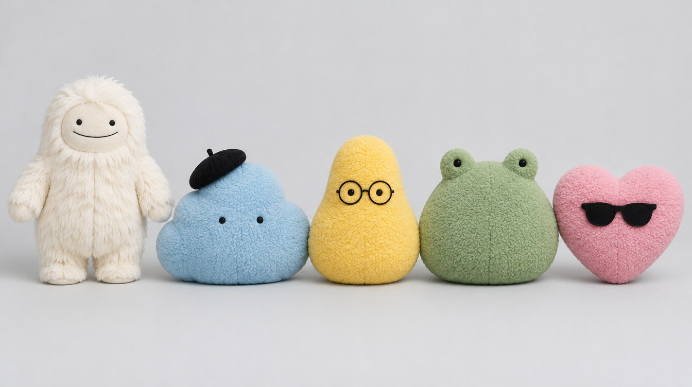
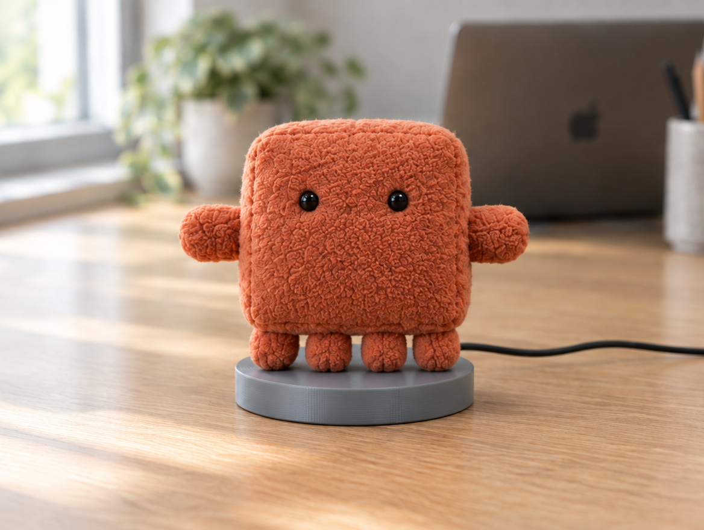
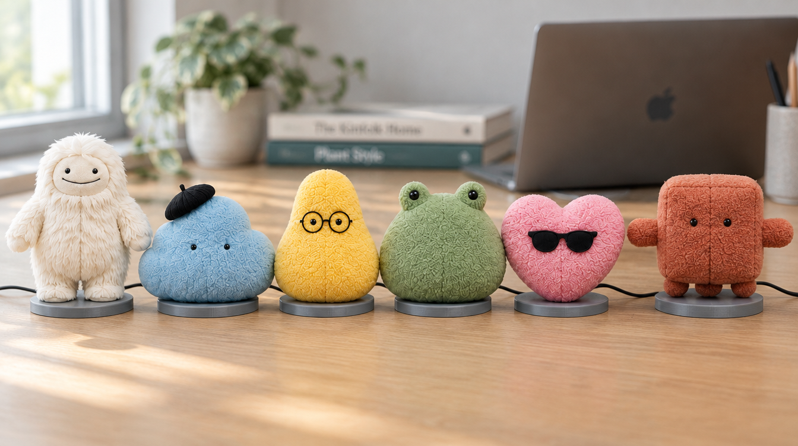
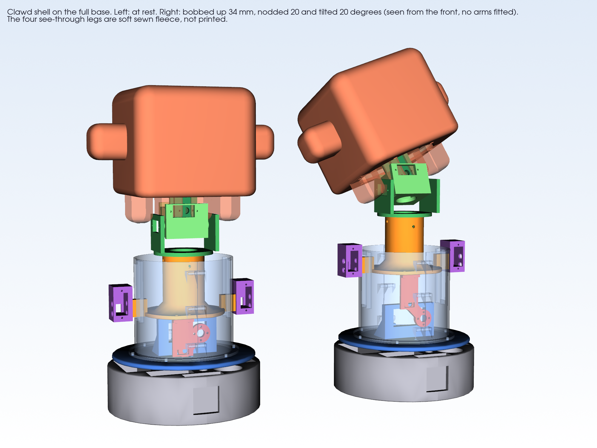
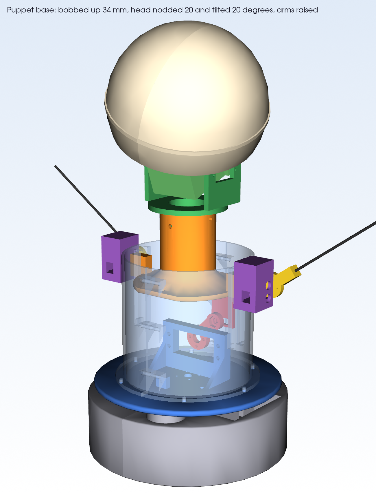
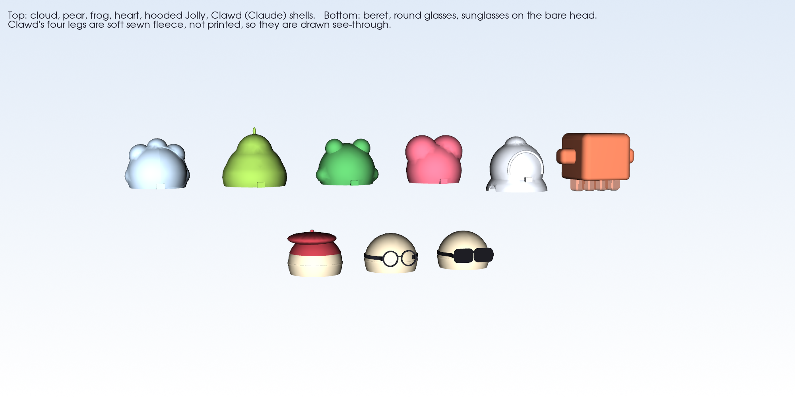

# Six controllable toys: build spec

17 Oct 2026, Dan. Rev 15, exported 18 Oct 2026 as a backup of the working spec. Rev 16, 20 Oct: Claude added as a sixth toy, with a six-toy parts and materials costing. Rev 17, 20 Oct evening: Claude redrawn as Clawd, the Claude Code mascot. Images are in docs/images.

Five Wi-Fi animatronic toys on one shared servo base: one Jolly (Meta's plush yeti, a body with arms) and four OpenAI dots (fuzzy blobs, built as motorised bobblehead bodies with no arms). Everything is printed, base and character shells alike, with fur or fleece glued over for the fuzzy look. Each toy carries its own ESP32; one MCP server we write drives all five, so an AI agent can turn, nod, bounce or wave any of them by name. Budget: about £250 all-in for the five. This page is for Cromwell: what the toys are, what moves, and what we would like printed.

*The five toys as they should read on the desk: Jolly plus the four dots. Concept render, 17 Oct.*

## The six units

All five share one printed base. Jolly adds an arms module; the dots are bobblehead bodies, so the head does the acting.

| # | Toy | Look | Body | Arms | How it expresses itself |
| --- | --- | --- | --- | --- | --- |
| 1 | Jolly | Cream long-pile yeti, hooded head and torso, mitten hands, flat oval face, dot eyes, smile line, no mouth opening | Full base: turn, bob, nod, tilt | Yes, one servo per shoulder | Waves, body bob, nod, head tilt |
| 2 | Dot: cloud | Blue fuzzy cloud with a beret | Bobblehead body | No | Eyes, bounce and squash, lean |
| 3 | Dot: pear | Yellow pear or rounded triangle with glasses | Bobblehead body | No | Eyes, bounce and squash, lean |
| 4 | Dot: frog | Green rounded frog blob | Bobblehead body | No | Eyes, bounce and squash, lean |
| 5 | Dot: heart | Pink heart with sunglasses | Bobblehead body | No | Eyes, bounce and squash, lean |
| 6 | Claude (added 20 Oct) | Clawd, the Claude Code mascot, as a terracotta fleece plush: boxy body, two stub arms out to the sides, four stubby legs, dot eyes, no mouth | Bobblehead body | No (stub arms are fixed) | Eyes, bounce and squash, lean |

Target size: 30 to 35 cm tall for Jolly, about 25 cm tall and wide for each dot. Neither character has a mouth, so there is no jaw mechanism. Jolly and the dots are Meta and OpenAI characters, and Claude is Anthropic's, so these are for personal and demo use only.

## Sixth toy: Claude (added 20 Oct)

Claude joins as a sixth toy, built like the four dots: same base, no moving arms, its own ESP32 and supply. Only the shell and the fleece are new.

*Claude as Clawd, concept render, 20 Oct*

The character is Clawd, the Claude Code mascot, made plush (changed on the evening of 20 Oct from an earlier starburst design based on Claude's spark logo). It has a chunky rounded box body, two short stub arms sticking straight out at the sides, and four stubby legs underneath. It has two black bead eyes, no mouth and no accessory, because the outline is the identity. The arms are fixed, part of the printed shell. The skin is short terracotta anti-pill fleece (about #C96A4A) glued over the shell, not long-pile fur, so the boxy edges stay crisp.

*All six on the desk, concept render, 20 Oct*

In software it is unit 6: the same moves as a dot, and `toy.all` includes it.

*CAD preview: Clawd's shell on the base, at rest, then bobbed up 34 mm with 20 degrees of nod and tilt; the see-through legs are soft fleece*

**CAD (20 Oct, redrawn as Clawd):** the Claude shell is exported as two STL halves, `shell_claude_left` and `shell_claude_right` (36 STLs in the set). It is a rounded box over the head with a hollow stub arm on each side. The four legs are soft sewn fleece on the skin, not printed.

- Size: 196 mm wide across the arms, 130 mm deep and 110 mm tall. The body is 126 × 130 × 110 mm with rounded edges. Each arm sticks out 35 mm and is 37 mm tall. The four legs are 22 × 30 mm and hang 28 mm below. Each half prints at 110 × 130 × 98 mm, so it fits the A1 mini.
- Wall: 1.0 mm, not the usual 1.5 mm. A box round the 120 mm head has much more surface than a sphere, so 1.5 mm walls take the head to about 277 g, over the 250 g budget. At 1.0 mm the pair is about 109 g near-solid, 27 g at normal shell settings, and the head is about 231 g, just under Jolly's 233 g. Use a brim and expect the first print to be fragile.
- Why soft legs: printed legs ended within 0 to 7 mm of the neck at full nod and tilt, and they would add about 18 g.
- Fit: the shell clears the base by at least 10.6 mm at full nod and full tilt, bobbed up or down.
- Leg check: the soft legs can still brush the neck gimbal. The outer pair is 5 mm clear at rest and touches at full nod and tilt. The inner pair sits over the neck at full length. Stuff them lightly, or make the inner two short flat pads, and test with real fleece.
- Printing: tree supports, about 15% of the surface overhangs (Jolly 15.8%). The roof, the arm ends and the rounded edges need them.

Not test-printed yet; the clearances are CAD distances with no allowance for print tolerance.

## What moves

Four servos in the core give every toy turn, bounce, nod and tilt. Jolly adds two shoulder servos. Nothing else moves; eyes are printed, embroidered or LED matrices behind the fabric.

| Motion | Mechanism | Servo | Range | On which toys |
| --- | --- | --- | --- | --- |
| Turn (yaw) | Printed turntable on a 70 mm lazy-susan bearing, servo at the base | MG996R | ±90° | All five |
| Bounce / squash | Torso column on two printed rails, lifted by a servo lever with a return spring | MG996R | 30 to 40 mm lift | All five |
| Nod | Two-axis printed neck gimbal, first axis | MG90D | ±30° | All five |
| Tilt | Same gimbal, second axis | MG90D | ±25° | All five |
| Arm swing (left, right) | Shoulder socket on the torso, printed horn, 2 mm aluminium armature wire sheathed in foam | 2 × MG90D | ±80° | Jolly only |

*Exploded view of one unit, bottom to top: base plate with the board, speaker, mic and power jack; bearing and turntable over the yaw servo; lift column with servo, lever and spring; two-axis neck gimbal; head sphere in two halves with the magnet collar; character shell lifting off. Concept render, not CAD.*

*CAD preview: the base bobbed up 34 mm, head nodded and tilted 20 degrees, arms raised*

**CAD status (17 Oct, evening):** the whole base is drawn in CadQuery and exported as 34 print-ready STL files: base plate halves, turntable with the 70 mm bearing seat, torso column with the bob carriage and lift lever, three-part neck gimbal, head sphere halves with the 110 mm collar and six magnet pockets, four skin rings, shoulder sockets with caps and arm horns, plus the five character shells (cloud, pear, frog, heart, Jolly) and the beret, round glasses and sunglasses clip-ons. Height 311 mm, bob throw 34 mm. One base set is about 520 g of filament, each shell 83 to 134 g. One thing to check before any real print: servo and bearing pocket sizes are from datasheets, not measured, so print one shoulder socket and the neck base first. **Jolly hood fixed (21:10):** the hood's open lower edge was raised from 58 mm below the head centre to 26 mm, so it is now a 126 mm hood over the head and top of the neck rather than a full-depth shell. It clears the torso column by at least 4.2 mm at rest even with full nod and full tilt together (14 to 16 mm with one axis alone), and the Jolly head drops to about 233 g, inside the 250 g neck-servo budget. About 38 mm of neck flange shows below the hood; the fur covers it. The character shells are placeholders in shape: a better route is to generate them from the render with an image-to-3D tool (Hi3D or similar), then hollow them to a 1.5 mm wall and cut the collar ring in. The base stays hand-drawn CAD.

*The six printed character shells (Claude added 20 Oct) and three clip-ons from the CAD, Jolly hood at its final height*

Head mass budget is 250 g including the skin, or the small gimbal servos stall. The head former is a hollow Ø120 mm printed sphere in two halves. Every skin attaches at a Ø110 mm collar carrying six 5 mm magnets at 60° spacing, the same arrangement Reachy Mini uses, so skins swap in seconds.

## Skins: all printed, fur or fleece over the top

Every character is a hollow printed shell that clips over the head sphere and torso and carries the magnet collar, so skins still swap in seconds. The fuzzy look comes from fabric glued over the shell: long-pile faux fur for Jolly, fleece or flock for the dots. Custom plush is parked; the base would take one later without changes.

| Toy | Shell | Finish | Filament |
| --- | --- | --- | --- |
| Jolly | Hooded head-and-torso shell in two halves, mitten hands printed on the arm wires, stubby feet on the base plate | Cream faux fur glued over; felt oval face patch; dot eyes and smile line in felt or stitching | about 300 g |
| Cloud | Cloud silhouette over the head sphere, beret printed on | Blue fleece wrap or flock | about 200 g |
| Pear | Pear or rounded-triangle shell, glasses printed as a clip-on | Yellow fleece or flock | about 180 g |
| Frog | Rounded frog shell with eye bumps | Green fleece or flock | about 200 g |
| Heart | Heart shell, sunglasses printed as a clip-on | Pink fleece or flock | about 200 g |
| Claude (Clawd) | Rounded box shell in two halves with two hollow stub arms, 1.0 mm wall; four soft sewn fleece legs | Short terracotta anti-pill fleece, black bead eyes | about 110 g |

Shell rules: 1.5 mm walls (two perimeters), 0 to 5% infill, no supports where possible. That puts a Ø120 mm head shell at about 70 to 80 g before fabric, well inside the 250 g head budget. Eyes are printed white discs with black pupils glued on; the same pockets take LED matrices later.

## Electronics per unit: the lean build

Each toy is self-contained: its own ESP32 on Wi-Fi, servos driven straight from its pins, its own 5 V supply. No servo board, no speaker or mic, no LED eyes in the first build; all three bolt on later. Prices are approximate multipack prices on Amazon UK and AliExpress, 17 Oct 2026.

| Part | Per toy | For five | Notes |
| --- | --- | --- | --- |
| ESP32 WROOM devkit | £4 | £20 | Runs the motion library and a small web API |
| 2 × MG996R | £8 | £40 | Turn and bounce, the heavy axes |
| 2 × MG90S (4 on Jolly) | £5 | £28 | Nod, tilt, arms |
| 5 V 4 A supply with barrel socket | £9 | £45 | Never power servos from USB; common ground |
| 70 mm lazy-susan bearing | £3 | £15 | Or a printed bearing |
| 12 × 5 mm N35 magnets | £2 | £10 | Two rings per toy |
| Springs, M2 and M3 screws, 2 mm armature wire, leads | £3 | £15 |  |
| Filament, about 3 kg |  | £45 | Bases and shells; we supply the spools |
| Faux fur, fleece or flock, glue |  | £25 |  |
| Total |  | about £243 | Spares not included |

### MVP costing (added 17 Oct, stays inside £250)

The £243 above is the whole five-toy spend. Any "per toy" figure is that total divided by five, not extra on top. Spend it in two steps so the first money proves the design before the rest goes:

| Step | What it buys | Cost |
| --- | --- | --- |
| 1. One toy, prove the base | 1 ESP32, 2 MG996R, 2 MG90S, 1 PSU, bearing, 12 magnets, 600 g filament, fleece | about £55 |
| 2. The other four | 4 ESP32, 8 MG996R, 10 MG90S (Jolly's arms included), 4 PSU, 4 bearings, magnets, 2.4 kg filament, fur and fleece | about £190 |
| Voice, first build | the spare Home Assistant Voice puck | £0 |
| Total |  | about £245 |

If step 1 shows we want headroom for spares, two cuts bring the total to about £205: one shared 5 V 10 A supply with a splitter lead instead of five PSUs (saves about £30, the toys then share one desk), and printed bearings instead of bought ones (saves about £12). Cromwell printing is assumed throughout; if he cannot, the printer in the backup plan below is the only line that would push past £250.

Later add-ons per toy: PCA9685 servo board £14, I2S amp and 40 mm speaker £10, mic £5, two 8×8 RGB eye matrices £16. Servo-care rules still apply: per-servo min and max in software, a mechanical stop on the bounce lift.

### Six-toy parts and materials, priced 20 Oct

Live UK prices on 20 Oct 2026, free delivery, everything arriving 22 to 29 Oct. Nothing bought yet. The counts include a few spares: one extra ESP32, four extra MG996R, two extra MG90S. For buying, this replaces the five-toy table above. Links: A = amazon.co.uk/dp/, E = ebay.co.uk/itm/.

| Part | Buy | Cost | Where |
| --- | --- | --- | --- |
| ESP32 WROOM-32 devkit, USB-C | 7 (6 + 1 spare) | £37.03 | E386194572609 |
| MG996R servo (turn, bounce) | 16 in 4-packs (12 needed) | £55.96 | E800790539208 |
| MG90S metal-gear servo (nod, tilt, Jolly's arms) | 16, a 10-pack and a 6-pack (14 needed) | £42.98 | A B0DGD55Q71, A B0C1N8VZ1S |
| 5 V 4 A supply, 5.5 × 2.1 mm plug | 6, one per toy | £64.14 | E156521193797 |
| Barrel sockets with screw terminals | 10-pack | £3.98 | A B07GJ43VKS |
| Turntable bearings, 72 mm | 8 | £12.58 | A B0FBLK3JLH |
| 5 × 2 mm magnets | 100 | £4.99 | A B0DQTVNWG2 |
| M2 to M5 screw and nut kit, spring assortment | 1 each | £10.79 | A B0GKGWVQNF, A B07WFPPXXX |
| Jumper wires, 20 servo extension leads | 1 kit, 2 packs | £20.97 | A B0BZ7PYYLB, A B08727XZBQ |
| PLA+ filament | 4.4 kg | £31.44 | A B0GTLQ31W1 |
| Long-pile faux fur, five colours at 50 × 180 cm (£8.99 each); terracotta anti-pill fleece for Clawd, 1 m × 150 cm; glue gun | 5 + 1 + 1 | £57.74 | A B0FB9CNYR7, A B0CVLJB56L, A B0DDKG29ND |
| **Total** |  | **£342.60** | about £57 a toy |

Optional: one PCA9685 servo board per toy adds £25.62 (A B0D7RQ5JXY), making £368.22. The lean build drives the servos straight from the ESP32, so these are only for tidier wiring.

**Against Cromwell's £70 list:** his list is per toy, so £420 for six, and it has three gaps. It has four servos, but Jolly needs six. It has two PCA9685 boards per toy, but one board drives 16 servos and the lean build needs none. It has no fur or fleece. The basket above is cheaper and complete. His £200 fee covers Stage 1, one working Jolly, only.

Checks before ordering:

- Fur: Clawd takes short terracotta fleece, not the long-pile fur. The listing is called "Terracotta" but shows no true swatch, so check it against #C96A4A (Neotrims "Rust Brick", A B07HWYN213, £8.25, is the fallback). The other five long-pile colours exist: cream, sky blue, yellow, light green and pink. The fur arrives last, on 29 Oct.
- Magnets: the 100-pack does not state its grade. Confirmed N35 costs £19.98 for 2 × 50 (A B00TACMMP0).
- One shared supply instead of six: not recommended. Six toys' servos at stall can draw more than a barrel splitter carries.
- Genuine TowerPro MG996R are £9 each at The Pi Hut, £126 for 14. The cheap servos and ESP32s are unbranded clones, which is normal for this kind of build.
- Filament: 4.4 kg covers six base sets at about 520 g each, plus the shells at about 0.8 kg, plus about 0.5 kg for failed prints. PETG for the gimbal and lift arm is not included.

## Voice and speech (added 17 Oct)

The toys need to listen and talk, not just move. Three ways to do it; we are going with the hybrid.

| Route | What it is | Cost for five | Verdict |
| --- | --- | --- | --- |
| A. Shared voice puck | One Home Assistant Voice Preview Edition (we have a spare) sits on the desk and does the wake word, hearing and speaking. Home Assistant's OpenAI integration answers (a text pipeline: speech to text, model, text to speech) and fires the toys' moves over the network. The voice comes from the puck; the toys move. | £0 | Day-one route. No extra parts. |
| B. Voice in every toy | A small I2S mic (INMP441) plus amp and 40 mm speaker (MAX98357A) in each base. The ESP32 streams audio to a small Python bridge that talks to OpenAI's live speech models (gpt-realtime-2.1, about $32 per million audio tokens in and $64 out; or gpt-live-1 at $0.05 a minute) and streams the reply back. The speak-bob follows the audio, so each character talks from its own body. | about £7 a toy at multipack prices (mic £2.50, amp £2.50, 40 mm speaker £1.50), about £35 for five. A later upgrade, outside the £250 and not needed for the first build. | v2 upgrade, the fun version. |
| C. Hybrid (chosen) | Start with A. Print the base with the speaker pocket, grille and mic port already in it, so B becomes a parts drop-in rather than a re-print. | £0 now, about £75 later | What we are doing. |

Two board facts shape this. On-device wake word (ESPHome microWakeWord) wants an ESP32-S3 with PSRAM, while Bottango only documents the classic ESP32-WROOM. So v1 keeps motion on a classic ESP32 per toy and lets the puck or the bridge PC do the listening; nothing on the toy has to hear a wake word. If we ever want each toy to hear on its own, that toy gets an ESP32-S3 and we drop Bottango for it.

What this means for the printed base plate: a Ø40 mm speaker pocket with a grille under it, a 3 mm mic port on the rim, and the barrel jack as drawn. Empty in v1, filled in v2.

## Software: Wi-Fi on every toy, one MCP server

We write the software ourselves. It follows the pattern already running on Dan's Walkie robot: each toy exposes a small HTTP API over Wi-Fi, and one Python MCP server on the home network wraps all five so any AI agent (Claude, or whatever is driving the demo) can call them as tools.

1. On the ESP32: Bottango exports the motion library (idle breathe, listen, think, speak-bob, celebrate, wave, nod-yes, tilt-curious) to run standalone. A thin REST layer adds `/pose`, `/play/<clip>`, `/say` and `/status`.
2. On the network: one MCP server with tools such as `toy.list`, `toy.set_mood(name, mood)`, `toy.react(name, clip)`, `toy.say(name, text)` and `toy.all(clip)` for group reactions. Speech drives the bounce and arm gestures from the audio loudness.
3. Per toy, an avatar profile (JSON): which modules are fitted, servo limits, eye style, idle style, voice. Swapping a skin means swapping the profile; the agent code never changes.

Voice: see the Voice and speech section below. First build: one shared voice puck on the desk does the listening and talking, and the toys' bounce and arm gestures follow the audio loudness. Later: a mic and speaker in each toy, streaming to OpenAI's live speech models. All five toys answer to the same server, so one agent can run a conversation across the room.

## What we would like from Cromwell

Printing, in two batches: one base set plus one dot shell first so we can prove the mechanism and the magnet swap, then the other four base sets and four shells once it moves. That is about 3 kg of filament and roughly 80 to 100 hours of printer time spread over a few weeks. We supply the spools, or pay for them. Parametric CAD (CadQuery) and STLs come from Dan, sized for FDM with no supports where possible.

| Part | Qty per unit | Qty for 5 | Material | Notes |
| --- | --- | --- | --- | --- |
| Base plate, two parts (Ø160 mm) | 2 | 10 | PLA | Pocket for steel washers as ballast; electronics bay |
| Turntable + bearing carrier | 2 | 10 | PLA | Fits a 70 mm lazy-susan bearing |
| Torso column, two halves with rails | 2 | 10 | PLA | 30 to 40 mm bounce travel |
| Bounce lift arm | 1 | 5 | PETG | Takes the lift load |
| Servo cradles (4 × MG90S, 2 × MG996R) | 6 | 30 | PLA | Snap-fit, M2 and M3 tabs |
| Neck gimbal, three parts | 3 | 15 | PETG | The only parts under real stress |
| Head sphere, two halves (Ø120 mm) | 2 | 10 | PLA | 2 walls, 5% infill to stay light |
| Magnet collar + mating ring | 2 | 10 | PLA | Six 5 mm magnet pockets at 60° |
| Shoulder sockets, horns, mitten hands | 6 | 6 | PLA | Jolly only (one set) |
| Character shells (cloud, pear, frog, heart, Jolly body) | 2 | 10 | PLA | Hollow, 1.5 mm wall, 0 to 5% infill |
| Clip-ons: beret, glasses, sunglasses | 1 | 3 | PLA | Small, quick |

Rough filament: 350 to 450 g per base set, 180 to 300 g per shell, about 3 kg in all. Roughly 20 base parts per unit plus 2 to 3 shell parts. Hardware we buy separately: servos, bearings, magnets, screws, wire, springs.

## If the print job is too much: backup plan

Nobody should be lumbered with 80 to 100 printer hours. Options, cheapest credible first (prices checked 17 Oct 2026, UK):

- Buy a Bambu Lab A1 mini (£169 on the UK store; 180 mm cube, so the Ø160 plate and the Ø120 sphere halves fit, the taller shells are tight). Printer plus 3 kg of filament is about £215, which beats every service we found for this much plastic, and the project owns a printer afterwards. The full-size A1 (256 mm cube, roughly £280 to £300) is the safer size for the shells.
- Online services: Craftcloud, JLC3DP and Protolabs Network all quote instantly from an STL upload but publish no per-gram rate. Rough expectation: £150 to £400 from JLC3DP (shipped from China, plus VAT) up to £450 to £900 from UK partners via Craftcloud. The one published UK rate (Reprap Ltd, £0.40 per cm³) comes to about £970 for the lot. Unverified until we upload the STLs.
- A peer maker on Fiverr at about £3.50 per printer hour comes to £280 to £350 for the run, filament unclear.

So: a first base set and one shell from Cromwell proves the design; if the full run is too much printer time, the A1 mini is the backup.

## Build order and open questions

1. Bench: ESP32 + two servos on external 5 V, first Bottango clip. One evening.
2. First base printed and assembled: turn, bounce, nod, tilt. First idle loop. One weekend.
3. First dot shell on, fleece over it. Prove the magnet swap.
4. Four more bases printed; three more shells dressed.
5. Jolly shell, fur wrap, arms module.
6. REST on each toy, the MCP server, avatar profiles, speech-driven bounce.
7. Later: LED eyes, speaker and mic on the toys, live AI mode.

Open questions

- [ ] Cromwell: printer bed size, and is PETG fine for the gimbal and lift arm, or all PLA?
- [ ] Cromwell: can the printer take 80 to 100 hours over two to three weeks without it being a pain?
- [ ] Cromwell: spools from us, or we pay for yours?
- [ ] Fuzzy finish on the dots: fleece wrap or flock? Flock is DIY, no UK service found.
- [ ] Bottango on the spare ESP32-C3 boards is unverified; a classic ESP32 WROOM is the safe buy.
